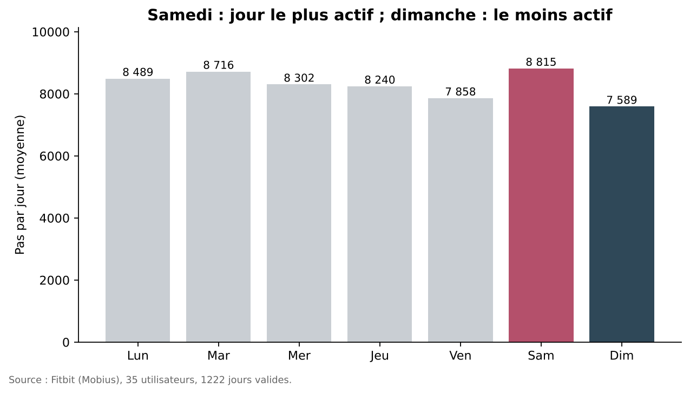
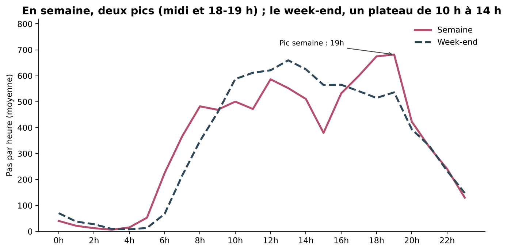
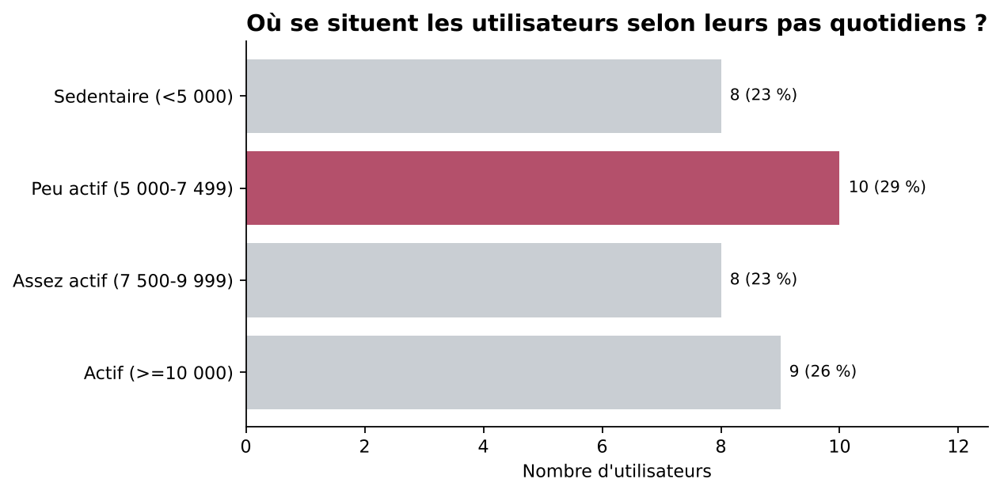
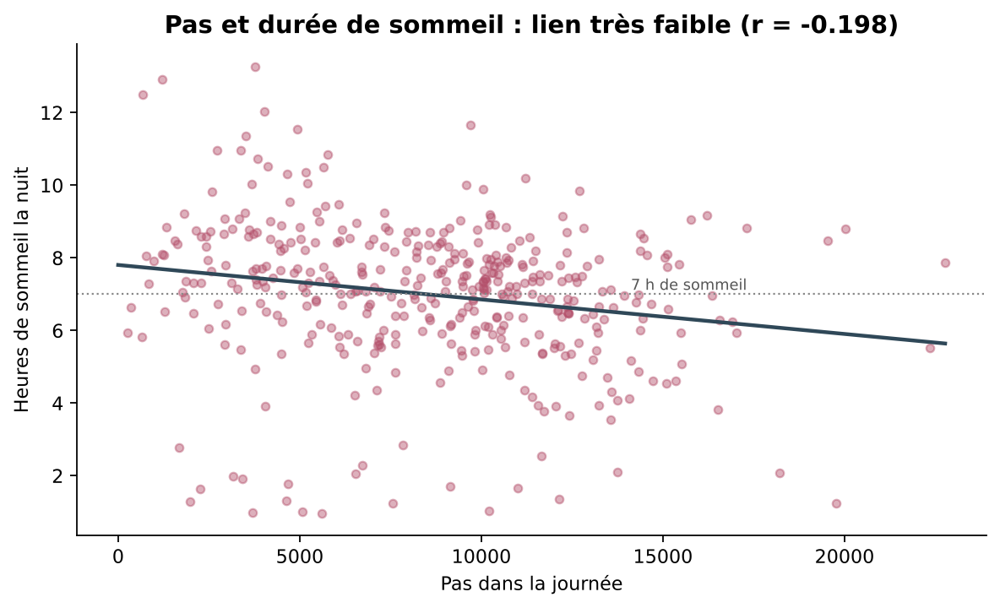
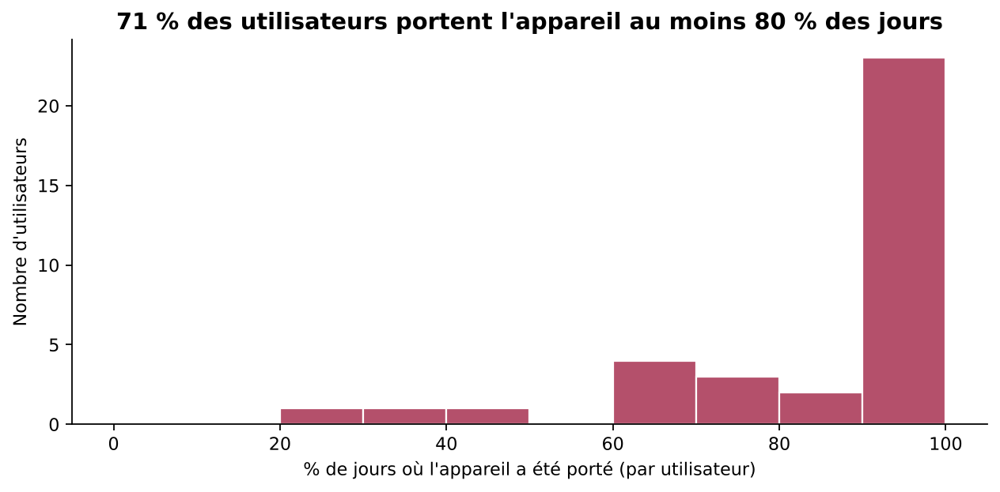

# Bellabeat : comment les gens utilisent-ils leurs appareils connectés ?

*Étude de cas d'analyse de données (Google Data Analytics) · Python (pandas, SciPy, Matplotlib)*

## 1. Ask : la mission

**Problème de l'entreprise.** Bellabeat, fabricant d'objets connectés orientés bien-être, veut croître sur un marché très concurrentiel. Elle ne sait pas encore finement comment les gens utilisent leurs appareils au quotidien.

**Ma mission.** Analyser les données d'usage de trackers Fitbit pour dégager des tendances, les appliquer à **un produit Bellabeat** et en tirer des recommandations marketing pour la direction (Urška Sršen, Sando Mur) et l'équipe d'analyse marketing.

**Questions guides.**
1. Quand et combien les utilisateurs bougent-ils ?
2. Quel est le lien entre activité et sommeil ?
3. Les utilisateurs portent-ils vraiment leur appareil de façon régulière ?

## 2. Prepare : les données

- **Source :** *FitBit Fitness Tracker Data* (Mobius, Kaggle, domaine public). Deux exports : 12/03-11/04/2016 et 12/04-12/05/2016.
- **Fichiers utilisés :** activité quotidienne (2 exports), pas par heure (2 exports), sommeil quotidien (export 2 uniquement).
- **Test ROCCC :**

| Critère | Verdict |
|---|---|
| Fiable | Moyen : données auto-déclarées par appareil, quelques jours sans port |
| Original | Oui, données d'une enquête réelle |
| Complet | **Non** : sommeil disponible pour seulement 24 utilisateurs |
| Actuel | **Non** : données de 2016 |
| Cité | Oui, source publique identifiée |

**Limites à garder en tête :** petit échantillon, données anciennes, aucune information de genre (alors que Bellabeat cible les femmes), aucune donnée Bellabeat. La documentation parle de 30 utilisateurs ; **j'en ai compté 35 identifiants** dans les fichiers (33 sur la seconde période).

## 3. Process : le nettoyage (journal complet dans `data_clean/cleaning_log.csv`)

| Problème | Règle | Lignes |
|---|---|---|
| Le 12/04 figure dans les 2 exports avec des valeurs différentes (version 1 = journée partielle) | Garder l'export 2 | 1 397 → 1 373 |
| Appareil non porté (moins de 100 pas, souvent 1 440 min « sédentaires ») | Exclure ; **seuil choisi par jugement** | 1 373 → **1 222** jours valides (151 retirés, 11 %) |
| Doublons dans le sommeil | Dédoublonner sur (Id, date) | 413 → 410 nuits |
| Dates au format texte | Conversion en dates, ajout du jour de semaine | — |

**Piège repéré sur la sédentarité.** Quand une nuit de sommeil est enregistrée, le temps passé au lit est **exclu** des « minutes sédentaires » ; sinon il y est inclus (écart médian vérifié : 0 minute). La sédentarité n'est donc comparable que sur les jours avec sommeil suivi. J'ai calculé les parts d'activité sur cette base seulement, et je n'interprète **pas** la corrélation sédentarité/sommeil (r = −0,66) : c'est un artefact, car une journée ne dure que 24 h.

## 4. Analyze et Share : les constats

### Constat 1. Les utilisateurs bougent modérément, avec un rythme hebdomadaire et horaire net
- Moyenne de **8 289 pas/jour** (médiane 7 886). **53 %** des jours dépassent 7 500 pas, **35 %** dépassent 10 000.
- Sur les jours avec sommeil suivi, 73 % du temps d'éveil suivi est sédentaire (≈ 11,9 h sur 16,3 h), 22 % en activité légère et **4 % seulement en activité modérée ou intense** (≈ 37 min/jour).
- Samedi est le plus actif (8 815 pas), dimanche le moins actif (7 589, soit −14 %). L'écart est modeste mais statistiquement détectable (Kruskal-Wallis, p = 0,04). Les observations d'un même utilisateur ne sont pas indépendantes : à lire avec prudence.
- **En semaine,** deux pics : midi (≈ 586 pas/h) et 18-19 h (≈ 682 pas/h), avec un creux à 15 h (≈ 380). **Le week-end,** un plateau de 10 h à 14 h (pic à 13 h).




### Constat 2. Les utilisateurs sont répartis presque également entre 4 niveaux d'activité
Sur 35 utilisateurs : 8 sédentaires (<5 000 pas), 10 peu actifs, 8 assez actifs, 9 actifs (≥10 000). Un objectif unique ne convient pas à tout le monde.



### Constat 3. Le sommeil est court et son suivi est inégal ; aucun lien clair avec l'activité
- Sommeil moyen de **6,99 h** (7,65 h au lit, efficacité 91,7 %). **44 % des nuits font moins de 7 h.**
- **27 % des utilisateurs de la période 2 n'ont jamais utilisé le suivi du sommeil**, et seule la moitié des utilisateurs du sommeil ont enregistré 20 nuits ou plus.
- Pas du jour et sommeil de la nuit **suivante** : r = −0,07 (n = 406). Dans les données, plus de pas va de pair avec moins de sommeil *le même jour* (r = −0,20), mais cela peut simplement refléter des journées plus longues. **Ces données ne montrent pas que l'activité améliore le sommeil**, et ne permettent pas de conclure en sens inverse.



### Constat 4. L'appareil est porté de façon régulière
**89 %** des jours enregistrés sont valides ; **71 %** des utilisateurs portent l'appareil au moins 80 % des jours.



## 5. Act : produit choisi et recommandations

**Produit choisi : Bellabeat Time (montre).** Le constat 4 montre qu'un appareil de poignet est porté presque tous les jours, et la montre permet d'envoyer des messages en temps réel. Les données ne comparent pas les formats : **c'est une hypothèse à tester**, et Leaf reste une alternative.

1. **Des rappels de mouvement calés sur les moments d'activité.** Proposer de courtes marches ou défis vers midi et 17-19 h, et un message « dimanche en mouvement » le jour le moins actif. *Preuve : constats 1 et 4.*
2. **Faire du sommeil un axe de communication et d'onboarding.** 44 % des nuits sont sous 7 h et 27 % des utilisateurs n'ont jamais suivi leur sommeil : parcours de découverte du sommeil et contenu dédié dans l'abonnement. *Preuve : constat 3.*
3. **Des objectifs personnalisés plutôt qu'un seuil unique de 10 000 pas.** Seuls 9 utilisateurs sur 35 sont dans ce niveau : proposer des paliers selon le niveau, via l'abonnement. *Preuve : constat 2.*

**Prochaines étapes :** tester ces idées sur les propres données de Bellabeat, inclure des données plus récentes et par genre, vérifier le seuil de non-port (100 pas).

## Reproduire le projet

```
python analysis.py <dossier_raw> <dossier_sortie>
```
Fichiers : `analysis.py` (nettoyage + analyse + graphiques), `data_clean/` (données nettoyées, journal, résultats), `images/`, `sql/` (équivalents BigQuery, non exécutés).
